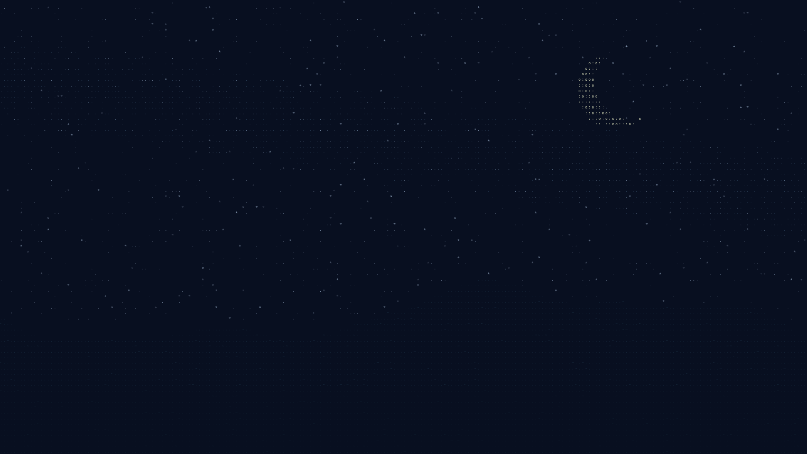
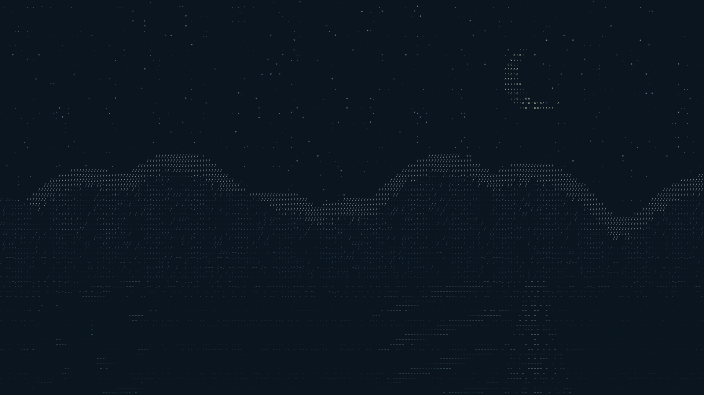

# Stillwater

Three quiet, animated ASCII landscapes: a koi pond, a night sky, and mountains above a misty lake.

Stillwater runs as a small native Wayland wallpaper on Omarchy/Hyprland. Standalone HTML versions work offline in a browser or a web wallpaper application.


## Install on Omarchy

Download [stillwater-install.sh](https://github.com/GotinhaAzul/stillwater/raw/refs/heads/main/stillwater-install.sh), then run it in a terminal inside your Omarchy desktop:

```sh
bash ~/Downloads/stillwater-install.sh
```

The installer starts the koi pond, adds application launcher entries, and enables autostart. It needs no root access or downloads. It supports Omarchy's Lua and older `.conf` autostart files, backs up that file before editing, and leaves your original static wallpaper in place underneath.

The bundled native binary targets x86-64 Linux. The installer checks compatibility before changing your desktop and can rebuild from the included source when a compatible development toolchain is available.

To verify the package without installing:

```sh
bash ~/Downloads/stillwater-install.sh --check
```

Running the installer again updates an existing installation while preserving your selected scene and frame rate. See [installer details](installer/README.md).

## Choose a scene

Search for **Stillwater** in your application launcher, or use:

```sh
stillwater pond
stillwater sky
stillwater mountains
stillwater pause       # toggle pause/resume
stillwater fps 8       # default: 12; supported: 1–30
stillwater status
stillwater disable     # restore static wallpaper, including after login
stillwater enable
```

`stillwater stop` stops the current animation without disabling the next login's autostart. `stillwater start` starts it again if enabled.





## Lightweight by design

One low-priority native C process, with no browser, video decoder, network access, or continuously running Python process.

- Colored character tiles and static scene data are cached.
- Animation copies changed character pixels directly into shared-memory buffers.
- Only changed screen regions are reported to the compositor.
- Compositor frame callbacks pace output; pause blocks on events without polling.
- The wallpaper is click-through, sits below windows, and handles output hotplugging and integer display scaling.

Reference live measurements at 1360×768 and 12 fps were approximately **16 MB RAM** and **0.5–1% of one CPU core**. Paused and display-off samples used zero CPU ticks. Hardware, output count, resolution, scaling, and compositor behavior affect resource use; compositor work is separate from these process measurements.

The optimized renderer reduced 1080p drawing time by 63–79% against the first native implementation while preserving comparison images byte-for-byte. Details and limits are in [performance notes](docs/performance.md).

## Browser versions

Open [web/index.html](web/index.html) locally to explore all three scenes. `web/pond.html`, `web/sky.html`, and `web/mountains.html` open with controls hidden. Each file is self-contained and works offline.

Press **W** for controls, **Space** to pause, or **1–3** to switch scenes. The interface includes speed adjustment and PNG export. Reduced-motion preferences start the scene paused. Use a wallpaper application that supports local HTML for animated desktop use; an ordinary image wallpaper setting supports the exported PNG stills.

## Build from source

Requirements: a C compiler, `pkg-config`, Cairo development files, Wayland development files, `wayland-scanner`, `wayland-protocols`, Python 3, and standard Linux build tools. Tests also use the Wayland server library.

On Arch/Omarchy, the relevant packages are `base-devel`, `cairo`, `wayland`, `wayland-protocols`, and `python`. On Debian/Ubuntu: `build-essential`, `pkg-config`, `libcairo2-dev`, `libwayland-dev`, `wayland-protocols`, and `python3`.

```sh
make build
make test
# Optional AddressSanitizer + UndefinedBehaviorSanitizer checks:
SANITIZE=1 make test
# Rebuild the self-contained installer with your local binary:
make installer
```

Run directly inside a Wayland desktop supporting layer-shell:

```sh
./native/build/stillwater-native --scene pond --fps 12
```

Render a still or benchmark without a desktop:

```sh
./native/build/stillwater-native --scene mountains --render mountains.png
./native/build/stillwater-native --scene pond --benchmark
```

Tests cover cached rasterization and partial damage against complete Cairo redraws, alternating buffer reuse, 1×/2× scaling, real Wayland frame commits in an isolated test compositor, pause/resume, and fresh/repeat installation in temporary homes. They do not connect to your desktop.

## Files and configuration

- Native source and controller: `native/`
- Installer source and packager: `installer/`
- Offline HTML wallpapers: `web/`
- Installation: `~/Tools/stillwater/`, with `~/.local/bin/stillwater` on PATH
- Settings: `${XDG_CONFIG_HOME:-~/.config}/stillwater/settings.json`
- Logs: `${XDG_STATE_HOME:-~/.local/state}/stillwater/wallpaper.log`

The vendored [wlr-layer-shell protocol](native/wlr-layer-shell.xml) preserves its upstream copyright and license notice.
