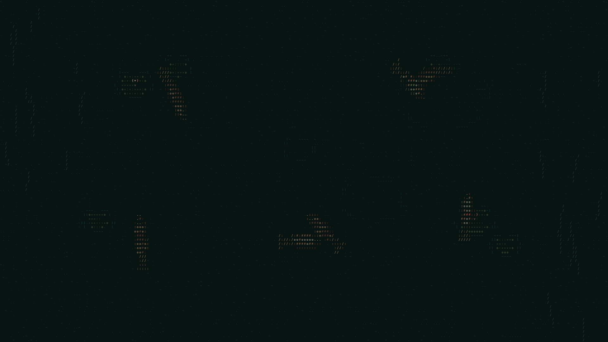
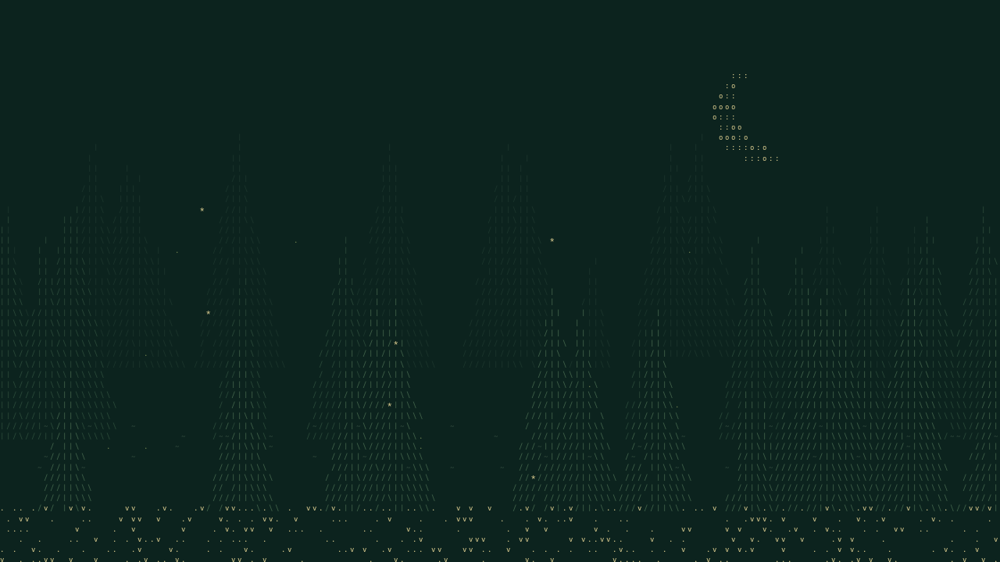
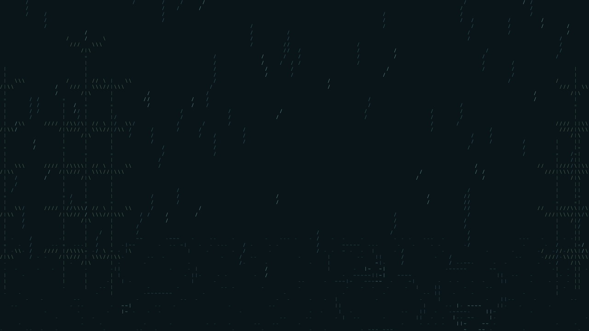
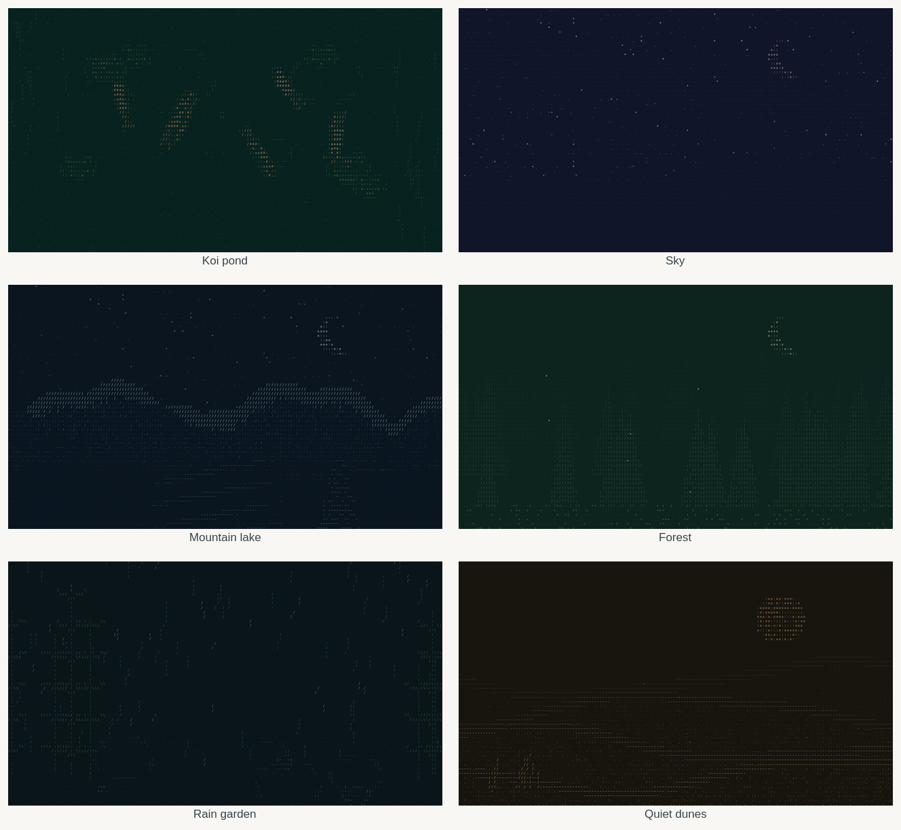

# Stillwater

Fourteen quiet, animated ASCII landscapes — spanning daylight, dusk and night — and a terminal interface for making the desktop your own.

Stillwater runs as a small native Wayland wallpaper on Omarchy/Hyprland. The terminal interface uses Python’s standard library and adds no dependencies. Standalone HTML versions of the original three scenes work offline in a browser or a web wallpaper application.



## Install on Omarchy

Download [stillwater-install.sh](https://github.com/GotinhaAzul/stillwater/raw/refs/heads/main/stillwater-install.sh), then run it in a terminal inside your Omarchy desktop:

```sh
bash ~/Downloads/stillwater-install.sh
```

The installer starts the koi pond, adds application launcher entries, and enables autostart. It needs no root access or downloads. It supports Omarchy's Lua and older `.conf` autostart files, backs up that file before editing, and leaves your original static wallpaper in place underneath.

The bundled native binary targets x86-64 Linux. The installer checks compatibility before changing your desktop and can rebuild from the included source when a compatible development toolchain is available.

To verify the package without installing:

```sh
bash ~/Downloads/stillwater-install.sh --check
```

Running the installer again updates an existing installation while preserving your selected scene and frame rate. See [installer details](installer/README.md).

## Switch scenes and settings

Run `stillwater` in a terminal, or open **Stillwater — Settings** in your application launcher:

```sh
stillwater tui
```

Use **Up/Down** to select a setting and **Left/Right** to change it. **Enter** saves and applies. **S** enables the wallpaper, **P** pauses/resumes, **X** restores your static wallpaper and disables animation at login, and **Q** closes the interface. Closing the TUI leaves the wallpaper running independently.

The interface controls the landscape, frame rate and animation speed. Settings stay pending until applied. If animation is disabled, applying settings saves them without starting a wallpaper. The interface handles small terminals and does not hold the controller lock while open.

| Landscape | Appearance | What moves |
|---|---|---|
| `pond` — Koi pond | Night | Koi, moon glitter, lily pads, a lit stone lantern |
| `sky` — Night sky | Night | Stars, the Milky Way, meteors, a sailboat on the swell |
| `mountains` — Mountain lake | Night | Slow mist and moonlit water |
| `forest` — Firefly forest | Night | Fireflies among evergreen silhouettes |
| `rain` — Rain garden | Day | Rain, puddles, bamboo, a moon gate and hydrangeas |
| `dunes` — Quiet dunes | Day | Sunlit dune faces, drifting sand, a camel caravan |





Each landscape is drawn for one appearance rather than recoloured from another. The koi pond, night sky, mountain lake and firefly forest are night pieces with their own moonlight and deep grounds; the rain garden and quiet dunes are daylight pieces built around pale mist, warm sand and a high sun. Scenery is composed from solid character grounds, hand-stamped sprites and ordered-dither shading, so surfaces stay calm while ridges, water and foliage keep their shape. Older theme preferences are retired automatically; your landscape and playback settings are preserved.



For scripts and quick changes:

```sh
stillwater forest       # choose a scene and enable the wallpaper
stillwater fps 8        # default 12; supported 1–30
stillwater speed 0.5    # default 1; supported 0.25–2
stillwater pause
stillwater status
stillwater status --json
stillwater list
stillwater disable      # static wallpaper, including after login
stillwater enable
```

`stillwater stop` stops the current animation without disabling the next login's autostart. `stillwater start` starts it again if enabled. With redirected input/output, bare `stillwater` prints status rather than entering the TUI. Landscape, frame-rate and speed changes preserve a running wallpaper’s pause state.

## Lightweight by design

One low-priority native C process, with no browser, video decoder, network access, or continuously running Python process.

- Colored character tiles and static scene data are cached.
- Animation copies changed character pixels directly into shared-memory buffers.
- Only changed screen regions are reported to the compositor.
- Compositor frame callbacks pace output; pause blocks on events without polling.
- The wallpaper is click-through, sits below windows, and handles output hotplugging and integer display scaling.

At 1920×1080 the six scenes draw in 0.08–0.57 ms per frame, or about 0.1–0.7% of one CPU core at 12 fps; peak renderer memory measured 20–22 MB. Pause blocks without polling and display-off periods use no frames. Hardware, output count, resolution, scaling, and compositor behavior affect resource use; compositor work is separate from these process measurements. Details and limits are in [performance notes](docs/performance.md).

## Browser versions

Open [web/index.html](web/index.html) locally to explore the browser demo. `web/pond.html`, `web/sky.html`, and `web/mountains.html` open with controls hidden. Each file is self-contained and works offline. The browser pages keep a separate three-scene renderer; the native wallpaper is the full six-landscape collection.

Press **W** for controls, **Space** to pause, or **1–3** to switch scenes. The interface includes speed adjustment and PNG export. Reduced-motion preferences start the scene paused. Use a wallpaper application that supports local HTML for animated desktop use; an ordinary image wallpaper setting supports the exported PNG stills.

## Build from source

Requirements: a C compiler, `pkg-config`, Cairo development files, Wayland development files, `wayland-scanner`, `wayland-protocols`, Python 3, and standard Linux build tools. Tests also use the Wayland server library.

On Arch/Omarchy, the relevant packages are `base-devel`, `cairo`, `wayland`, `wayland-protocols`, and `python`. On Debian/Ubuntu: `build-essential`, `pkg-config`, `libcairo2-dev`, `libwayland-dev`, `wayland-protocols`, and `python3`.

```sh
make build
make test
# Optional AddressSanitizer + UndefinedBehaviorSanitizer checks:
SANITIZE=1 make test
# Rebuild the self-contained installer with your local binary:
make installer
```

Run directly inside a Wayland desktop supporting layer-shell:

```sh
./native/build/stillwater-native --scene dunes --fps 12 --speed 0.5
```

Render a still or benchmark without a desktop:

```sh
./native/build/stillwater-native --scene mountains --render mountains.png
./native/build/stillwater-native --scene pond --benchmark
```

Tests cover cached rasterization and partial damage against complete Cairo redraws, alternating buffer reuse, 1×/2× scaling, real Wayland frame commits in an isolated test compositor, pause/resume, fresh/repeat installation in temporary homes, legacy settings migration, and keyboard interaction with the real TUI through pseudo-terminals. Renderer checks cover all six landscape palettes, three sizes and 1×/2× scaling. They do not connect to your desktop.

## Files and configuration

- Native source, controller and curses interface: `native/`
- Installer source and packager: `installer/`
- Offline HTML wallpapers: `web/`
- Installation: `~/Tools/stillwater/`, with `~/.local/bin/stillwater` on PATH
- Settings: `${XDG_CONFIG_HOME:-~/.config}/stillwater/settings.json`
- Logs: `${XDG_STATE_HOME:-~/.local/state}/stillwater/wallpaper.log`

The vendored [wlr-layer-shell protocol](native/wlr-layer-shell.xml) preserves its upstream copyright and license notice.

Additional native scenes: `lighthouse`, `cabin`, `deep`, `blossom`, `train`, `aurora`, `autumn`, and `cat`. Select them through the terminal interface or `stillwater <scene>`.
